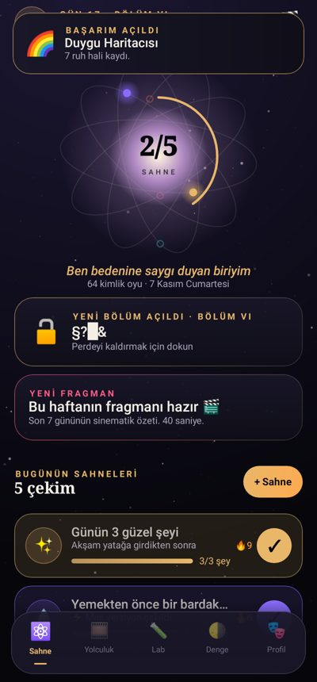
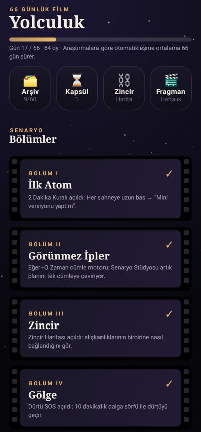
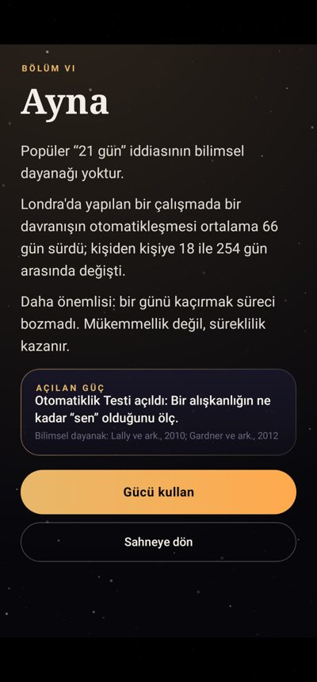
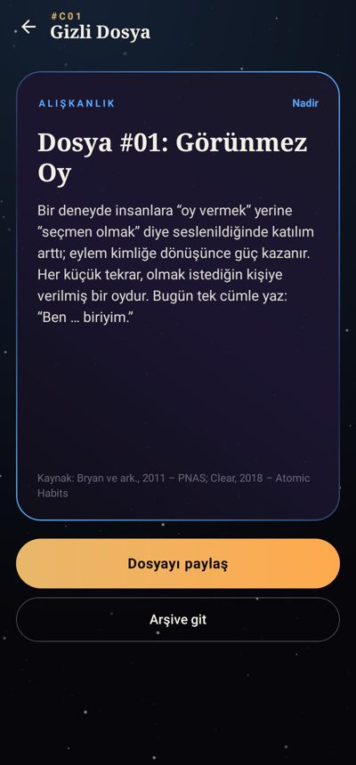
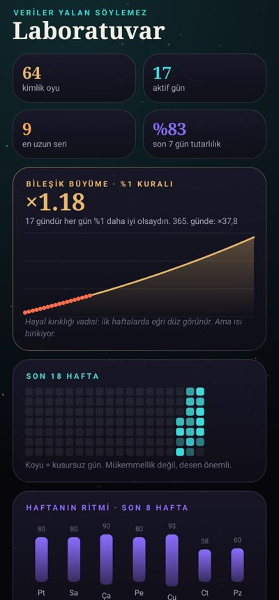
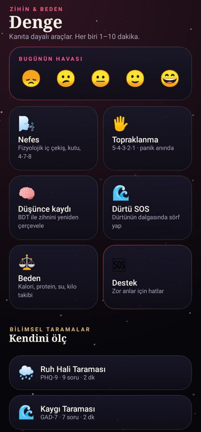

# ⚛️ Atomik: Alışkanlık Koçu

Bilime dayalı, sinematik bir alışkanlık uygulaması. 66 günlük yolculuk bir film gibi bölümlere ayrılır. Her tekrar, olmak istediğin kişiye verilmiş bir "kimlik oyu"dur.

James Clear'ın *Atomik Alışkanlıklar* kitabındaki ilkelerden ve hakemli davranış bilimi araştırmalarından ilham alır. Kitaptan metin kopyalanmamıştır; tüm içerik kaynak gösterilerek özgün olarak yazılmıştır. Uygulamanın yazar ya da yayıncıyla bir bağlantısı yoktur.

<p>
  
  
</p>

## Öne çıkanlar

| Alan | Neler var |
|---|---|
| **Sinematik deneyim** | Daktilo efektli prolog, sinema bantları, film greni, yıldız alanı, dönen "kimlik atomu". Kilitli bölümlerin adları şifreli görünür (merak boşluğu, Loewenstein 1994). |
| **Üşengeç dostu kurulum** | Ad, hedef, kimlik ve enerji seviyesi seçilir; "Senaryo yazılıyor…" sahnesinin ardından hazır plan gelir. Yazmak zorunlu değil. |
| **Tek dokunuş** | Ana ekran, bildirim ("✓ Yaptım" / "⚡ Mini versiyon") ve ana ekran widget'ı üzerinden tamamlama. |
| **4 yasa** | Senaryo Stüdyosu: Görünür, Cazip, Kolay, Tatmin edici. Kötü alışkanlıklar için tersleri. Canlı "eğer–o zaman" cümlesi önizlemesi. 60 bilimsel şablon. |
| **Gölge modu** | Kötü alışkanlıklar, temiz gün sayacı, 3/5/10 dakikalık dürtü sörfü (Bowen & Marlatt), tetikleyici analizi. |
| **Yönetmen (koç)** | Çevrimdışı kural motoru: iki kez kaçırma uyarısı, alışkanlığı küçültme ya da büyütme önerisi (Goldilocks), ruh hali düşüşünde davranışsal aktivasyon, gizli haftalık örüntüler. |
| **Gizli dosyalar** | Günün sahneleri bitince açılan, nadirlik dereceli 60 bilimsel kart. Koleksiyon arşivi. |
| **Yolculuk** | 11 bölüm (İlk Atom → Otomatik Pilot → Sezon 2). Bölümler gün ve oy sayısıyla açılır, her biri yeni bir güç açar. |
| **Laboratuvar** | Isı haritası, haftanın ritmi, %1 bileşik büyüme eğrisi, Lally (2010) otomatiklik eğrisi, SRBAI otomatiklik testi. |
| **Denge** | Ruh hali ve şükran kaydı, nefes (fizyolojik iç çekiş, kutu, 4-7-8), 5-4-3-2-1 topraklanma, BDT düşünce kaydı, PHQ-9 / GAD-7 / SCOFF taramaları, kriz destek ekranı. |
| **Beden** | Mifflin-St Jeor ile kalori, protein ve su hedefi; güvenli kilo hızı ve kilo grafiği. Zayıflık riski ya da SCOFF uyarısı varsa kilo verme önerileri kapanır. |
| **Paylaşım** | Film afişi tarzında paylaşım kartları: seri, haftalık fragman, kimlik manifestosu, gizli dosya ve final sertifikası. |
| **Diğer** | Çoklu profil, zaman kapsülü (geleceğe mektup), zincir haritası, haftalık fragman, dondurma hakları, 18 başarım, PIN kilidi, JSON yedekleme ve geri yükleme, CSV dışa aktarma. |

Veriler yalnızca cihazda saklanır. Hesap, reklam ya da takip yoktur.

> ⚠️ Bu uygulama tıbbi bir cihaz değildir ve profesyonel tanı ya da tedavinin yerini tutmaz.

## Teknik yapı

- Kotlin 2.0 ve Jetpack Compose (Material 3); minSdk 26, targetSdk 35
- kotlinx.serialization ile atomik JSON deposu (`data/Store.kt`)
- AlarmManager ile bildirimler, Glance ile widget, FileProvider ile paylaşım
- Saf Kotlin alan katmanı (`domain/`): istatistik, bölümler, koç, bilim formülleri
- İçerik (`content/`): 60 şablon, 60 kart, 40 kaynak

## Derleme

```bash
./gradlew assembleDebug          # app/build/outputs/apk/debug/app-debug.apk
./gradlew testDebugUnitTest      # alan testleri + Robolectric ekran/akış testleri
```

GitHub Actions (`.github/workflows/atomik-apk.yml`) her push'ta APK'yı derler ve **Atomik-Aliskanlik-Kocu-APK** adıyla yükler.
